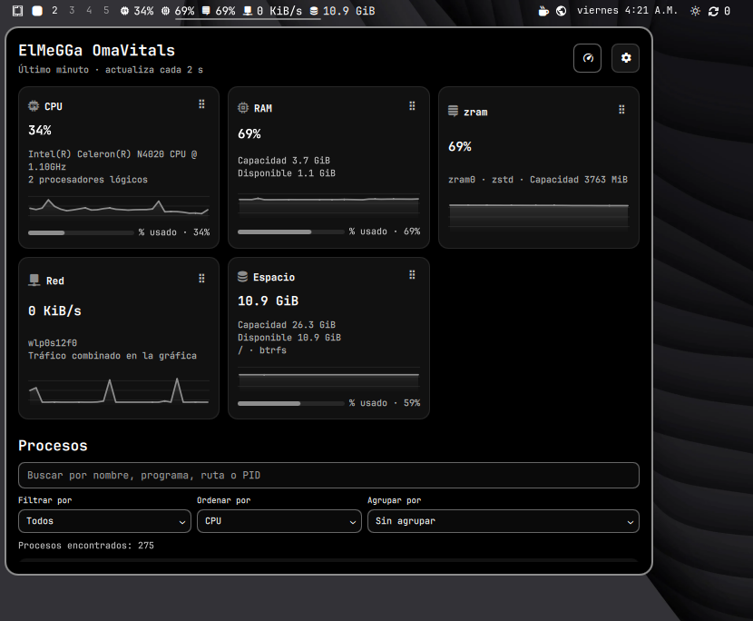

# ElMeGGa OmaVitals



Monitor de recursos para la barra de Omarchy. Muestra lecturas en vivo de CPU, RAM, zram, swap, GPU, disco, red, almacenamiento, batería y temperatura de CPU. Los sensores y datos de GPU disponibles dependen del equipo y sus controladores.

El panel muestra gráficas del último minuto, barras de porcentaje y detalles de hardware. La sección de procesos permite buscar por nombre, programa, ruta o PID, filtrar por actividad y agrupar por programa o proceso padre.

## Requisitos

- Omarchy con el shell Quattro y soporte para complementos de barra
- Python 3 disponible como `python3`
- `lspci` es opcional y ayuda a identificar la GPU. En equipos NVIDIA, el monitor puede usar `nvidia-smi` si ya está disponible.

Las mediciones se recogen en el equipo. El monitor de procesos toma muestras mientras el panel está abierto. La interfaz está disponible en español e inglés.

## Instalación

Instala el complemento desde su repositorio público con el instalador de Omarchy.

```sh
omarchy plugin add https://github.com/megga-ernesto/omavitals-monitor.git --enable
```

Haz clic en el widget para abrir el panel. El engranaje despliega los ajustes de métricas, formatos de lectura, columnas y tamaños. El botón que está a su lado alterna entre las gráficas y la lista de procesos. Arrastra el tirador **⠿** de una tarjeta o pastilla para reordenar los medidores en el panel y en la barra.

## Actualización y desinstalación

Las instalaciones hechas con `omarchy plugin add` se actualizan desde su repositorio Git con este comando.

```sh
omarchy plugin update elmegga.omavitals-monitor
```

Para quitar el complemento de la barra puedes deshabilitarlo. Para eliminar su copia local, usa el comando de desinstalación.

```sh
omarchy plugin disable elmegga.omavitals-monitor
omarchy plugin remove elmegga.omavitals-monitor
```

## Desarrollo

Desde la raíz del repositorio, valida el manifiesto antes de publicar cambios.

```sh
omarchy plugin validate .
```

## Licencia

[MIT](LICENSE).
